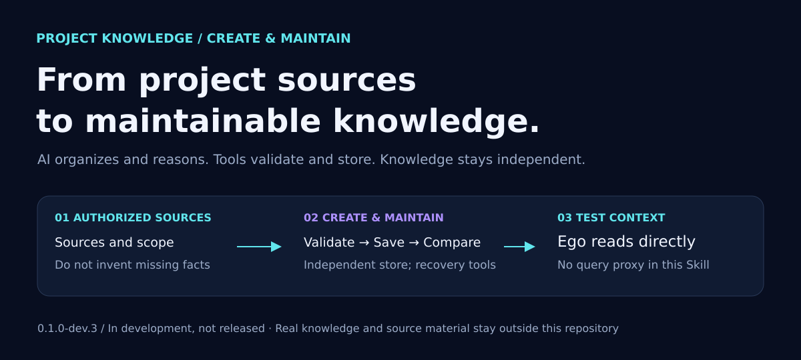
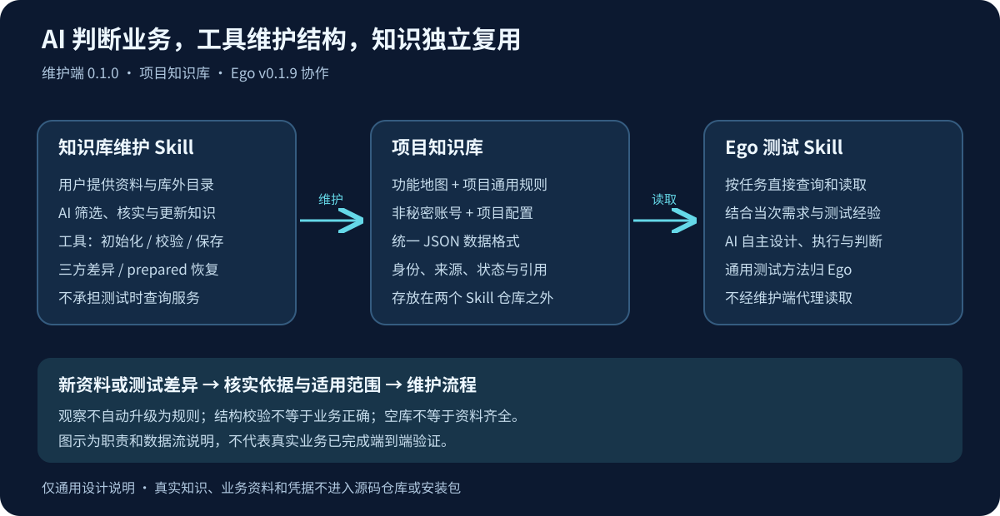

<h1 align="center">Project Knowledge Creation &amp; Maintenance Skill</h1>

<code>project-knowledge-maintainer</code>

<strong>English</strong> · <a href="README.md">简体中文</a> <a href="#installation-and-development-usage">Installation and development usage</a> · <a href="skills/project-knowledge-maintainer/SKILL.md">Skill guide</a> · <a href="docs/project-knowledge-lightweight-design.md">Knowledge structure</a> · <a href="skills/project-knowledge-maintainer/references/format-and-tools.md">Formats &amp; commands</a> · <a href="docs/development-validation.md">Validation status</a>

**An independent Skill for creating and maintaining project knowledge across projects.** AI organizes knowledge from authorized sources; tools initialize, validate, save, compare, and recover it. Consumers such as Ego read the independent knowledge store directly.

> **Current stable version: 0.1.0; knowledge format: v3.** Initialization, validation, incremental saves, recovery of prepared transactions, and local Git three-way comparison are implemented for four types of records. AI handles source organization and business judgment. See [release validation](docs/v0.1.0-release-validation.md). Linked technical documents are currently in Chinese.

## Purpose

Starting from sources the user authorizes, the current AI session creates and maintains independent project knowledge. It focuses on project-wide rules and navigation, with lightweight records for user-provided account information and project configuration. Features are lightweight indexes, not detailed requirements copied feature by feature. Rules and navigation retain their sources, scope, and confirmation status. Configuration records only what the user provides, without imposing business attributes or a registry. Knowledge is isolated by project. When sources are insufficient, an empty or partial store is acceptable; missing facts must not be invented.

This project creates and maintains knowledge. Consumers such as Ego Lite read, query, and use the resulting files directly, without invoking this Skill during testing. This project does not implement Ego Lite's general testing practices or runtime query functions.

## Working with Ego

This project is the **creation and maintenance side**; [AI Autonomous Testing · Ego Lite](https://github.com/99Like-wjj/ai-autonomous-testing-ego-lite) is the **reading and testing side**. This public repository provides generic Skill definitions, tools, and synthetic examples; real project knowledge remains outside the repository.

1. The user provides sources and explicitly chooses a knowledge directory outside the source repository. The maintenance AI decides which project-wide knowledge to retain, then uses local tools to initialize, validate, and save it.
2. The independent knowledge directory uses shared format v3. It contains a feature map, project-wide rules, non-secret account records, and project configuration, together with identity and source information. It is not either Skill's installation directory.
3. The testing AI uses Ego to query and read relevant knowledge for the task, then combines it with general testing practices and current requirements to design, execute, and judge tests. Runtime queries do not pass through the maintenance Skill.
4. New sources and differences return to the maintenance workflow for source and scope checks. Test observations do not automatically overwrite confirmed rules.

General testing practices belong in Ego. Project-specific rules, navigation, and configuration belong in that project's knowledge store. An empty store can be created when sources are unavailable. Passing structural validation does not establish that business knowledge is complete or correct.

## Essential privacy boundary

**Never upload real project knowledge files or original source materials to this repository, even when it is Private.** Real inputs, generated knowledge, test data, and evidence stay outside the repository by default, at a location explicitly confirmed by the user. Examples must be entirely synthetic. `.gitignore` is not a confidentiality guarantee.

Read [AGENTS.md](AGENTS.md) before starting any work.

## Documentation

- [AGENTS.md](AGENTS.md): privacy boundaries, commit checks, and development limits.
- [Skill entry point](skills/project-knowledge-maintainer/SKILL.md): AI workflow, project-wide knowledge selection, and operating boundaries.
- [Scope and development handoff](docs/scope.md): goals, non-goals, and acceptance direction.
- [Data specification v3](docs/project-knowledge-lightweight-design.md) and [JSON Schema](schemas/project-knowledge.schema.json): the four record types, shared metadata, and external fields. The [historical v1 draft](docs/data-contract-draft.md) is retained as design history.
- [v0.1.9 knowledge maintenance design](docs/v0.1.9-requirements-and-design.md): historical v1-stage design. Current behavior and format are defined by the v3 design, operating guide, and source code.
- [Initialization and first-build design](docs/initialization-and-first-build-design.md): initialization intent and historical design, with current v3 implementation differences listed at the start.
- [Ego knowledge use and retrieval design (current v3)](https://github.com/99Like-wjj/ai-autonomous-testing-ego-lite/blob/f437c64/docs/project-knowledge-lightweight-integration-design.md): consumer-side business queries and testing integration, documented in the Ego project.
- [Ego implementation review](https://github.com/99Like-wjj/ai-autonomous-testing-ego-lite/blob/f437c64/docs/v0.1.9-current-state-review.md): evidence for the consumer's source and general testing guidance review.
- [Example guide](examples/README.md): entirely synthetic knowledge and source materials, not real business evidence.
- [Formats and local commands](skills/project-knowledge-maintainer/references/format-and-tools.md): requests, saving, and recovery.
- [Development validation](docs/development-validation.md): actual validation results and limitations.

## Installation and development usage

Requires Node.js >=22. Run `npm ci` and `npm run build` in this source repository. The CLI is at `.build/src/cli.mjs`. Users describe their goals and provide sources in natural language; AI prepares tool requests. Users do not need to hand-write JSON.

See the format guide for initialization, validation, saving, three-way comparison, and recovery commands. Run `npm run typecheck`, `npm test`, `npm run check:public`, and `git diff --check` for development checks. See [release and installation instructions](docs/releasing.md) and [CHANGELOG](CHANGELOG.md). No open-source license is declared.

## Versions and reading order

The maintenance Skill's own version is **0.1.0**, developed alongside Ego **v0.1.9**. The data contract version is **v3**. These are separate version identifiers. Install the complete ZIP attached to the Release; the source Skill subdirectory alone is not a complete installation.

| Development stage | Main change | Status |
| --- | --- | --- |
| 0.1.0 / format v3 | Account and project configuration become lightweight records within the four record types | Stable version |
| 0.1.0-dev.2 / format v2 | Four-part knowledge layout and maintenance/reading contract | Historical design and validation records |
| 0.1.0-dev.1 / format v1 | General topic knowledge, initialization, incremental maintenance, and three-way comparison | Historical design and validation records |

For current use, start with the Skill entry point and the formats and tools guide. For development, read the v3 design and Schema next. Historical documents preserve facts from their time; do not use them to generate older formats or infer current release status. Only v3 is currently supported; older formats are not migrated automatically.

## Feedback and contact

Report bugs or suggest improvements through [GitHub Issues](https://github.com/99Like-wjj/project-knowledge-maintainer/issues) or the contacts below. Include the version, reproduction steps, and redacted errors or screenshots. Do not submit real project knowledge, original business materials, passwords, tokens, keys, or confidential company information.

- Author: [99Like-wjj](https://github.com/99Like-wjj)
- Email: [wjj990517@gmail.com](mailto:wjj990517@gmail.com)
- WeChat: A2326543144

  
- QQ: 2326543144
- X: [@99Like_ovo](https://x.com/99Like_ovo)
