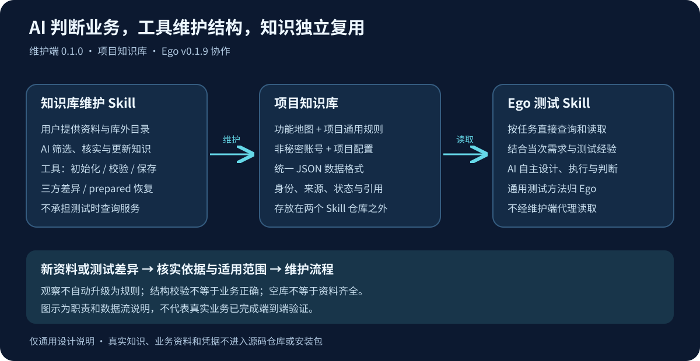

# project-knowledge-maintainer

独立、可跨项目复用的「项目知识库创建与维护 Skill」。

> **当前为本地开发版 0.1.0-dev.3，知识格式 v3。** 已实现四类资料的初始化、校验、增量保存、prepared 事务恢复及本地 Git 三方差异；AI 负责资料整理和业务判断。尚未正式发布；见[开发自测](docs/development-validation.md)。

## 定位

从用户授权提供的项目资料出发，由当前 AI 初始化并维护独立的项目知识资产，重点提炼项目内通用规则与导航，并轻量登记用户提供的账号和项目配置；功能只保留轻量索引，不逐功能录入细化需求。规则与导航保留来源、适用范围及确认状态；配置只整理用户提供的信息，不预设业务属性或注册表。不同项目的知识隔离；资料不足时可创建空库或部分知识，不编造事实。

本项目负责知识的创建与维护。Ego Lite 等使用方负责直接读取、查询和使用知识产物，不要求测试时调用本 Skill。本项目不承接 Ego Lite 的通用测试经验优化或运行时查询实现。

## 与 Ego 配合使用

本项目是 **创建与维护端**，[AI 自主自动化测试 · Ego Lite](https://github.com/99Like-wjj/ai-autonomous-testing-ego-lite) 是 **读取与测试端**。当前仓库为私有仓库，需要已获授权的 GitHub 账号访问；本开发分支尚未合并或发版。

1. 用户提供资料和明确的库外知识目录，维护 AI 判断哪些项目通用知识值得保留，再调用本地工具初始化、校验和保存。
2. 独立知识目录采用共享格式 v3，包含功能地图、项目通用规则、非秘密账号配置和项目配置，以及身份与来源信息；不是两个 Skill 的安装目录。
3. 测试 AI 按任务让 Ego 直接查询和读取相关知识，再结合通用测试经验与当次需求设计、执行和判断。运行时不经维护 Skill 代理查询。
4. 新资料或差异需要维护时，回到维护流程核实来源和适用范围；测试观察不自动覆盖已确认规则。

“通用测试经验”属于 Ego；只对某个项目适用的规则、导航和配置属于该项目知识库。没有资料可以先建空库，结构校验通过不代表业务知识完整或正确。

## 最重要的约束

**真实项目知识文件及原始资料不得上传到本仓库，即使仓库是 Private。** 真实输入、生成的知识库、测试数据与证据默认存放在仓库外；位置由用户明确确认。示例仅允许完全合成内容。`.gitignore` 不是保密保证。

开始任何工作前，先阅读 [AGENTS.md](AGENTS.md)。

## 目录

- [AGENTS.md](AGENTS.md)：隐私红线、提交检查与开发边界。
- [Skill 入口](skills/project-knowledge-maintainer/SKILL.md)：AI 使用方式、通用知识筛选和操作边界。
- [范围与开发交接](docs/scope.md)：目标、非目标和后续验收方向。
- [数据规范v3](docs/project-knowledge-lightweight-design.md)、[JSON Schema](schemas/project-knowledge.schema.json)：四类资料、共用元数据和外部字段；[历史v1草稿](docs/data-contract-draft.md)保留为设计历史。
- [v0.1.9 知识维护设计](docs/v0.1.9-requirements-and-design.md)：v1 阶段设计历史；当前格式和行为以 v3 设计、运行指南及源码为准。
- [初始化与首次建库设计](docs/initialization-and-first-build-design.md)：初始化意图与历史设计，文首先列出当前 v3 实现差异。
- [Ego 知识使用与检索设计（当前 v3）](https://github.com/99Like-wjj/ai-autonomous-testing-ego-lite/blob/f437c64/docs/project-knowledge-lightweight-integration-design.md)：使用方负责的按业务查询及测试接入，正文位于 Ego 项目。
- [Ego 现状核对](https://github.com/99Like-wjj/ai-autonomous-testing-ego-lite/blob/f437c64/docs/v0.1.9-current-state-review.md)：使用方源码与通用经验审核依据。
- [示例说明](examples/README.md)：完全合成知识和原始资料，非真实业务证据。
- [格式与本地命令](skills/project-knowledge-maintainer/references/format-and-tools.md)：请求、保存与恢复方法。
- [开发自测](docs/development-validation.md)：实际验证结果及限制。

## 开发使用

Node.js >=22，在本源码仓库运行 npm ci、npm run build。CLI 位于本仓库的 .build/src/cli.mjs。用户以自然语言提供目标和资料，AI 准备工具请求，不需要用户手写 JSON。

初始化、校验、保存、三方比较和恢复的命令见格式指南。自测运行 npm run typecheck、npm test、npm run check:public 和 git diff --check。当前没有正式分发、Tag、Release 或新增许可证声明。

## 版本与阅读顺序

维护 Skill 自身版本为 **0.1.0-dev.3**，与 Ego **v0.1.9** 配合开发；数据契约版本为 **v3**。三者不是同一个版本号。当前没有正式安装包，不要把源码构建目录当成安装交付。

| 开发阶段 | 主要变化 | 状态 |
| --- | --- | --- |
| 0.1.0-dev.3 / 格式 v3 | 四类资料中的账号和项目配置改为轻量记录 | 当前开发版本，待人工审阅 |
| 0.1.0-dev.2 / 格式 v2 | 四类知识布局与维护、读取契约 | 历史设计与验证记录 |
| 0.1.0-dev.1 / 格式 v1 | 通用主题知识、初始化、增量维护和三方差异 | 历史设计与验证记录 |

当前使用先读 Skill 入口和格式与工具指南；开发再读 v3 设计及 Schema。历史文档保留当时事实，不用于生成旧格式或推断当前发布状态。当前只支持 v3，不自动迁移旧格式。
